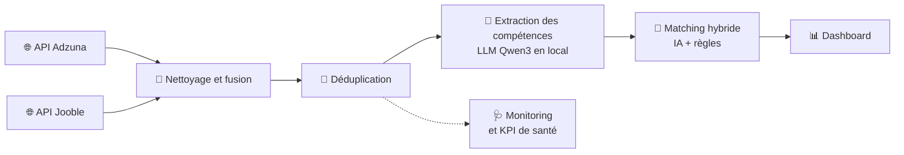
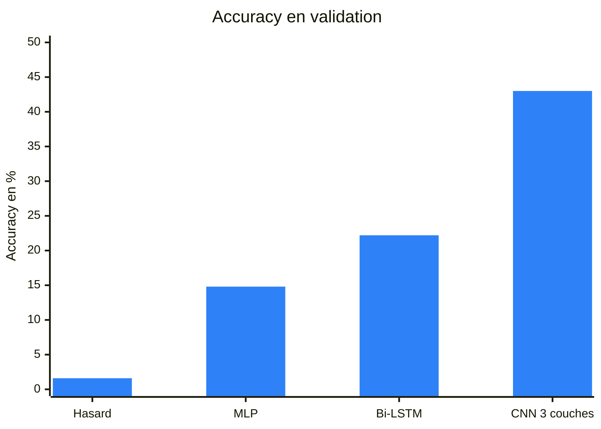
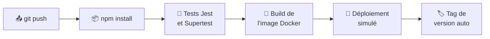
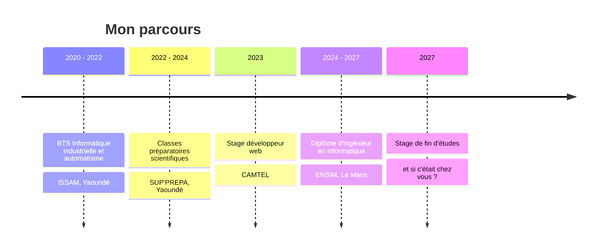

  

  

  
  
  

  
  
  

  <a href="#-en-bref">En bref</a> ·
  <a href="#-ma-boîte-à-outils">Outils</a> ·
  <a href="#-projets">Projets</a> ·
  <a href="#-expérience-et-engagement">Expérience</a> ·
  <a href="#-parcours">Parcours</a> ·
  <a href="#-contact">Contact</a>

---

## 👋 En bref

Je suis **Joël TCHINDA TAPA**, élève-ingénieur en **5e année à l'ENSIM**, l'École Nationale Supérieure d'Ingénieurs du Mans, en option IPS.

Je transforme des **données brutes en modèles prédictifs et en tableaux de bord** utiles à la décision. Mon expérience en **développement web, mobile et API** me permet ensuite d'intégrer ces résultats dans de vraies applications. J'aime aussi les projets qui touchent au réel : **capteurs physiologiques, objets connectés, réalité virtuelle**.

> 🎯 Je recherche un **stage de fin d'études de 6 mois à partir de mars 2027**, en priorité en **Data et IA**, puis en **développement**. Basé au Mans, je suis **mobile dans toute la France**.

<table>
  <tr>
    <td width="33%" valign="top" align="center">
      <h3>🧠 Data Science & IA</h3>
      Analyse exploratoire, feature engineering, modèles prédictifs, deep learning, LLM en local, traitement du signal
    </td>
    <td width="33%" valign="top" align="center">
      <h3>🛠️ Data Engineering & BI</h3>
      Pipelines Python automatisés, API, SQL, qualité des données, KPI, dashboards Power BI, Streamlit et Chart.js
    </td>
    <td width="33%" valign="top" align="center">
      <h3>💻 Développement</h3>
      API REST Spring Boot, Node.js, Angular, React, Android en Kotlin, CI/CD avec Docker et GitHub Actions
    </td>
  </tr>
</table>

---

## 🧰 Ma boîte à outils

  
    
  
    
  
    
  

            

---

## 🚀 Projets

<i>Clique sur un projet pour le dérouler 👇 · 🧑 projet personnel · 👥 projet d'équipe</i>

### 📊 Data, BI & IA

<b>🏆 Scoring client en assurance</b> · prédiction de souscription et aide à la décision · 🧑 · <i>2025-2026</i>

 

**🎯 Objectif**
Un assureur santé veut proposer une **assurance véhicule** à ses clients. Seuls **12,3 %** des clients de l'historique se sont montrés intéressés : appeler tout le monde coûte cher. Le projet identifie les clients à fort potentiel pour concentrer les appels commerciaux sur eux.

**🧪 Démarche**
Analyse exploratoire sur **381 109 clients**, feature engineering avec des variables d'interaction, preprocessing avec un `ColumnTransformer`, Random Forest optimisé par **GridSearchCV** pour gérer le déséquilibre des classes, puis scoring de **127 037 clients** et segmentation marketing selon la probabilité de souscription.

**📈 Résultats**

  
  
  
  

Un **dashboard Streamlit de 5 pages** présente le projet aux équipes métier : contexte, exploration interactive avec Plotly, modélisation, **simulateur de score** en direct et **aide à la décision** avec export CSV de la liste d'appels.

  

**🧰 Stack**     

<b>🔎 Smart Internship Match</b> · pipeline de collecte et de matching d'offres de stage avec un LLM local · 🧑 · <i>2026</i>

 

**🎯 Objectif**
Construire de bout en bout un pipeline qui collecte des offres de stage, en extrait les compétences, les compare à mon profil et m'aide à décider chaque semaine **où postuler et qui relancer**.

**📈 Résultats**

  
  
  
  

- Deux sources aux formats différents fusionnées, avec une **déduplication normalisée**, y compris des offres republiées par des sites agrégateurs.
- Compétences extraites par **Qwen3 via Ollama**, en local, en environ **6 secondes par offre**. Ses erreurs ont été **classées par relecture humaine**, puis compensées par une **détection déterministe** : sans elle, 30 % des correspondances auraient été manquées.
- Un **dashboard de 8 types de visuels**, chacun justifié par la décision qu'il éclaire, et un **script de monitoring** qui suit relances, fraîcheur des collectes et taux de réponse.

**🧰 Stack**      

 

<b>📁 Portfolio Business Intelligence</b> · 5 projets data publiés avec leur dashboard en ligne · 🧑 · <i>2026</i>

 

Une série de projets du cours de Business Intelligence de l'ENSIM, réunis dans l'organisation **[joel-tchinda-business-intelligence](https://github.com/joel-tchinda-business-intelligence)**. Chacun suit la même chaîne : **collecte automatisée**, nettoyage, calcul de **KPI**, **dashboard publié sur GitHub Pages**, puis analyse critique des limites.

<table>
<tr>
<td width="50%" valign="top">

#### 🇪🇺 EU Capitals Dashboard
Classer les capitales européennes pour un voyage selon un **score météo** et un **score CO2** du trajet, pondérés à 60 / 40. Madrid arrive en tête, avec **0,81** en météo et **0,71** en CO2. Mise à jour **chaque lundi**, avec un seul appel groupé à l'API au lieu de 26.

</td>
<td width="50%" valign="top">

#### 🚌 Smart Mobility Le Mans
Suivre les **retards et perturbations** du réseau de bus et de tram SETRAM à partir des horaires théoriques et des données temps réel, et comparer l'**offre de transport à la population** de chaque commune.

 

</td>
</tr>
<tr>
<td width="50%" valign="top">

#### 🕸️ Du scraping aux KPI
Mesurer la part des offres d'ingénieur qui demandent du **CI/CD** et du **cloud**, pour aider l'ENSIM à adapter ses cours. Offres collectées sur France Travail et Indeed, compétences extraites par un **LLM**, seuls les KPI agrégés sont publiés.

 

</td>
<td width="50%" valign="top">

#### 📈 Séries temporelles CO2
Analyser le **CO2 atmosphérique à Marseille** avec l'API Open-Meteo : nettoyage, détection des trous, moyenne mobile, **lissage exponentiel** et **projection de tendance**. Collecte automatisée par **GitHub Actions**, avec nouvelles tentatives en cas d'échec.

 

</td>
</tr>
<tr>
<td colspan="2" valign="top">

#### 🚚 Dashboards logistiques
Un réseau de **3 entrepôts et 20 villes françaises**, trois dashboards pour trois décisions : quelles routes prioriser pour réduire le **CO2**, où se concentrent les **coûts**, et faut-il **ouvrir un entrepôt** à Bordeaux ou Marseille, ou fermer Lille. Avec un entrepôt à Marseille, la **distance moyenne passe de 168 km à 115 km**.

 

</td>
</tr>
</table>

**🧰 Stack**     

<b>♟️ IA d'aide à la décision pour Othello</b> · prédire le coup d'un expert · <i>2026</i>

 

**🎯 Objectif**
Prédire le coup joué par un expert parmi les **64 cases** du plateau, en comparant trois architectures de réseaux de neurones.

**📈 Résultat** · après réglage de l'optimiseur, du learning rate et de la taille des batchs, le CNN atteint **43 %**, contre **1,6 %** pour un choix au hasard.

**🧰 Stack**  

<b>🧠 Charge cognitive des conducteurs</b> · interface cerveau-machine · 👥 équipe de 3 · <i>2026</i>

 

**🎯 Objectif**
Estimer la charge cognitive de conducteurs à partir de leurs signaux cérébraux, avec le jeu de données **CL-Drive**.

**🧪 Démarche**
Prétraitement des signaux **EEG** avec filtrage et gestion des valeurs manquantes, extraction de caractéristiques : puissance par bande de fréquence, entropie spectrale, paramètres de Hjorth, complexité. Comparaison de plusieurs modèles de classification, évalués en **validation croisée** et en **leave-one-subject-out**, pour vérifier que le modèle se généralise à de nouveaux conducteurs.

**🧰 Stack**   

<b>🏥 OpenHealth</b> · pollution et santé publique en France · 👥 · <i>2025</i>

 

**🎯 Objectif**
Croiser des données ouvertes de **santé** et de **pollution** pour suivre l'évolution des pathologies en France, sur **5,2 millions de lignes**.

**📈 Résultats**
Un pipeline de nettoyage et de jointures avec les données géographiques, puis un **dashboard Power BI de 3 pages** : vue France, analyse par pathologie, sexe et âge, prévalence par région.

**🧰 Stack**   

<b>🧪 FirmFactor</b> · analyse d'avis clients en ligne · 👥 équipe de 3 · <i>projet de fin d'études, en cours</i>

 

Projet de fin d'études sur toute l'année 2026-2027 : collecte d'avis clients publics par **web scraping**, dans un cadre légal validé par l'encadrant, sur plusieurs secteurs comme le commerce, les voyages et la livraison. Stockage et traitement en **SQL**, analyse des avis, et une version **Android en Kotlin** de la plateforme est prévue. Le dépôt est privé, car les données collectées ne peuvent pas être publiées.

**🧰 Stack**    

### 💻 Développement web, API & DevOps

<b>🤖 Chatbot Telegram</b> · API REST Spring Boot et bot météo et blagues · 🧑 · <i>2025-2026</i>

 

**🎯 Objectif**
Un bot Telegram qui répond aux messages des utilisateurs en appelant des API externes, adossé à une API REST sécurisée.

**⚙️ Ce que fait le projet**
- Approche **API-first** : contrat décrit dans `openapi.yaml`, interfaces Java générées par `openapi-generator`, documentation **Swagger UI**.
- Bot à l'écoute par **long polling**, qui répond à `meteo <ville>`, `meteo prochains jours <ville>`, `blague`, `blague bonne`…
- **Météo** actuelle et prévisions à 3 jours via OpenWeatherMap, **blagues** via JokeAPI avec filtrage par note et **CRUD complet**.
- **Authentification par token Bearer** avec un filtre Spring et **gestion d'erreurs centralisée** avec des réponses JSON homogènes.

  
  

**🧰 Stack**       

<b>⏱️ 24 Heures du Code</b> · hackathon de 24 h sur le défi proposé par Covéa · 👥 équipe de 5 · <i>mars 2026</i>

 

**🎯 Objectif**
En 24 heures, construire un client capable de jouer à un **jeu d'exploration maritime** fourni par le défi : piloter un bateau, découvrir la carte, gérer l'énergie et les ressources, améliorer son entrepôt et échanger sur une place de marché.

**⚙️ Ce que fait le projet**
- Un **back-end Node.js / Express** qui interroge l'API du jeu et écoute les événements via un **broker de messages RabbitMQ**.
- L'état de la partie est centralisé côté serveur, sauvegardé en JSON et dans **Supabase**.
- Un **dashboard React** pour suivre la partie en direct : grille de la carte avec mer, sable et rochers, zones stratégiques à explorer, statistiques, historique et commandes de déplacement.

**🙋 Ma contribution** · la centralisation de l'état du jeu côté serveur, sa sauvegarde en JSON et la synchronisation des données du joueur.

**🧰 Stack**      

<b>🚢 Portfolio DevOps</b> · site personnel avec une chaîne CI/CD complète · 🧑 · <i>2026</i>

 

**🎯 Objectif**
Développer un portfolio avec un formulaire de contact, et **automatiser sa validation** à chaque modification du code.

**📈 Résultats**
Un serveur **Node.js / Express** avec envoi d'emails par **Nodemailer**, des tests qui vérifient les routes, le formulaire et la page 404, une image **Docker** et un lancement par **Docker Compose**.

**🧰 Stack**       

<b>🛎️ Gestion de conciergerie</b> · application de gestion des clients et des commandes · 🧑 · <i>2026</i>

 

**🎯 Objectif**
Concevoir de A à Z une base de données et une application pour gérer les clients et les commandes d'une conciergerie.

**⚙️ Ce que fait le projet**
Une base **MySQL** hébergée en ligne et une interface **Streamlit** : liste et recherche des clients, création et modification, historique et export des commandes, ajout d'articles et **génération de factures**.

**🧰 Stack**    

<b>💻 PCFinder</b> · site de recommandation d'ordinateurs · 👥 · <i>2025</i>

 

**🎯 Objectif**
Aider à choisir un ordinateur grâce à trois parcours : **guidé**, **simplifié** et **configuration technique**.

**🙋 Ma contribution** · le parcours simplifié, avec un **filtrage dynamique** du catalogue selon les critères transmis par l'URL, des composants réutilisables et le routage Angular.

**🧰 Stack**  

### 📱 Mobile

<b>🎉 CrewUp</b> · application Android pour organiser des sorties entre amis · 🧑 · <i>2026</i>

 

**🎯 Objectif**
Créer un « crew », inviter ses amis, **voter pour la date**, se répartir ce qu'il faut prévoir et discuter dans un **chat dédié**. Projet réalisé seul, **de la maquette Figma jusqu'à l'application**.

  
  
  

**⚙️ Fonctionnalités**
- Connexion par email ou avec **Google**, contrôle de la robustesse du mot de passe, profil avec autocomplétion de la ville.
- Création d'un crew en 3 étapes avec choix du lieu sur une **carte OpenStreetMap**, puis invitation des amis ou partage d'un lien.
- **Hub du crew** : vote pour la date, tâches avec la personne qui s'en charge, **chat en temps réel**, participants.
- Système d'amis, notifications, historique des sorties et **score de fiabilité** sur le profil.

  
  
  

**🧰 Stack**       

### 🔌 Capteurs, signal & objets connectés

<b>🪶 FeatherMind</b> · biofeedback en temps réel inspiré de la sieste de Salvador Dalí · 👥 équipe de 3 · <i>2026</i>

 

**🎯 Objectif**
Aider l'utilisateur à atteindre l'**état hypnagogique**, juste avant l'endormissement. Une **plume descend à l'écran** à mesure qu'il se détend, et une **alarme le réveille** quand elle atteint le seuil, comme la clé que Dalí laissait tomber.

**⚙️ Ce que fait le projet**
- Acquisition en temps réel à **100 Hz** sur une carte **PLUX / BITalino** : respiration, pouls et accéléromètre.
- Un **score de relaxation explicable**, sans machine learning : **50 %** respiration, **35 %** immobilité, **15 %** qualité du pouls.
- Une seconde alarme en cas de **mouvement brusque**, des courbes affichées en direct et des modes simulation et démo pour tester sans capteurs.

**🙋 Ma contribution** · le traitement du signal et les scripts d'enregistrement des données brutes.

**🧰 Stack**    

<b>📡 Réseau d'objets communicants</b> · réseau sans fil XBee et Arduino · 👥 · <i>2026</i>

 

**🎯 Objectif**
Construire un réseau d'objets communicants composé d'un **émetteur**, d'un **relais**, d'un **hub** et d'**actionneurs**.

**🙋 Ma contribution** · le **nœud actionneurs**, qui pilote une LED RGB et un servomoteur en réaction aux messages reçus.

**🧰 Stack**  

### 🥽 Réalité virtuelle

<b>🏛️ ImmerScience, « Le Musée de l'Oubli »</b> · vivre la maladie d'Alzheimer de l'intérieur · 👥 · <i>2026</i>

 

**🎯 Objectif**
Une visite de musée en **réalité virtuelle** qui fait ressentir la progression de la maladie d'Alzheimer, testée sur casque **Meta Quest 3**.

**⚙️ Ce que fait le projet**
Les salles se dérèglent au fil de la visite : tableaux et objets qui réagissent quand on les **fixe du regard**, zones inquiétantes, murs qui basculent, ascenseur automatique, ambiances sonores et bruits de pas, mélodie de guitare jouable à deux mains, menu de réglages en VR.

**🙋 Ma contribution** · la construction de la scène avec l'entrée, le toit et la mise en place des objets dans les salles, les paramètres de simulation XR et un script d'ascenseur automatique en C#.

**🧰 Stack**   

<b>🎵 VR Music Explorer</b> · exploration d'une salle de musique en réalité virtuelle · 👥 · <i>2026</i>

 

**🎯 Objectif**
Une galerie où **chaque porte fait découvrir un style musical**.

**⚙️ Ce que fait le projet**
Portes qui s'ouvrent à l'approche, **carrousels 3D d'hologrammes d'albums**, robot animé, musique d'ambiance globale, message d'accueil et focus de la caméra sur les éléments clés.

**🙋 Ma contribution** · la configuration du casque VR, les scripts d'interaction, les animations des portes et des hologrammes, et l'interface.

**🧰 Stack**  

---

## 💼 Expérience et engagement

<b>🌍 Stagiaire développeur web</b> · CAMTEL, Cameroun Télécommunications · <i>juin à août 2023</i>

 

- ⚡ **Temps de chargement du site réduit de 35 %** selon GTmetrix, en optimisant les images et les requêtes à la base de données.
- ✅ Mise en place de **tests unitaires automatisés**.
- 🔄 Rituels agiles, daily, sprint planning et review, dans une **équipe de 6 développeurs**.

- ⏱️ **24 Heures du Code**, Le Mans, mars 2026 : hackathon en équipe sur le défi Covéa.
- 🏛️ **Bureau exécutif de l'AECM** : organisation d'événements et accueil des nouveaux étudiants.
- 🏁 **Emplois étudiants** en parallèle des études : préparateur de commandes en intérim, agent d'accueil et agent d'entretien lors des événements de l'Automobile Club de l'Ouest.

---

## 🎓 Parcours

---

## 🤝 Savoir-être

  
  
  
  
  
  
  

---

## 📈 Mon activité GitHub

  
  

  

---

## 📬 Contact

  
  
  

  

  

